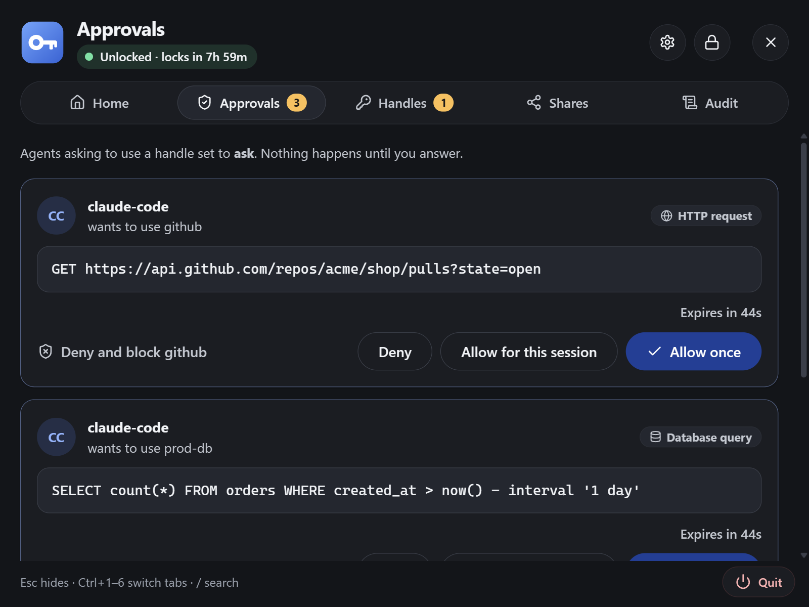
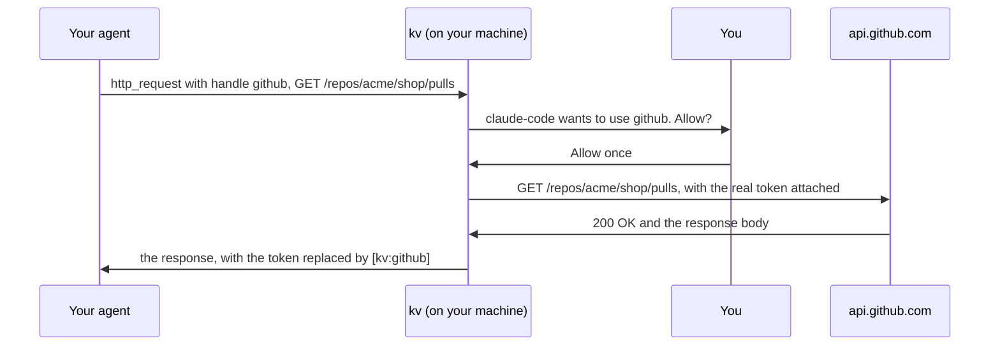
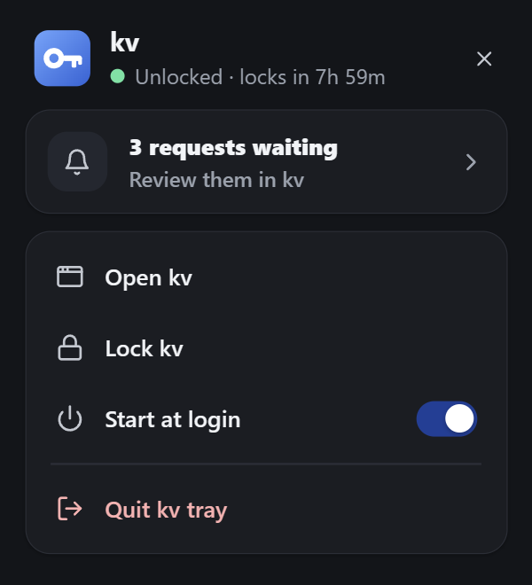
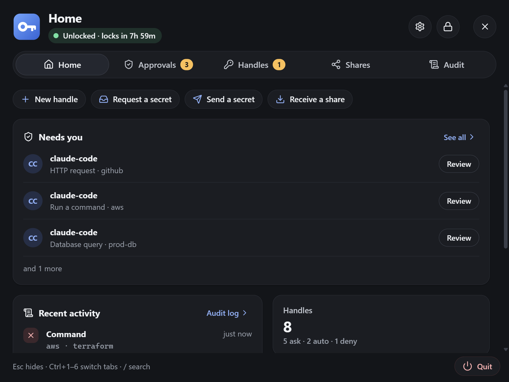
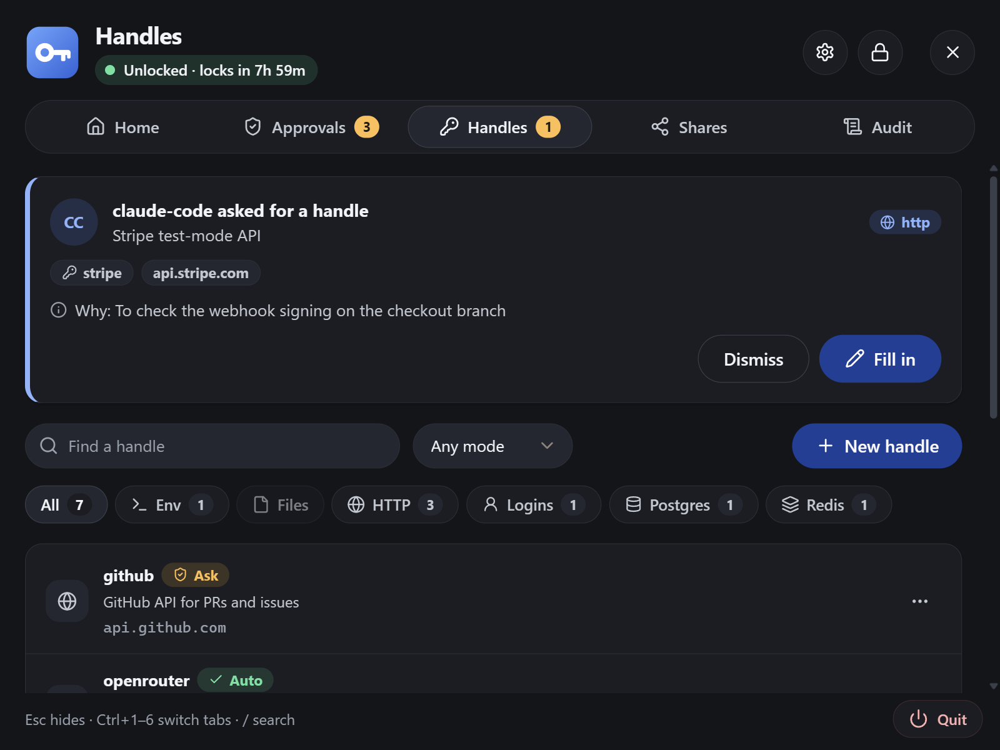
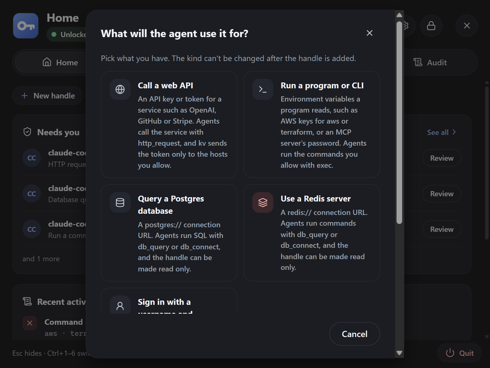
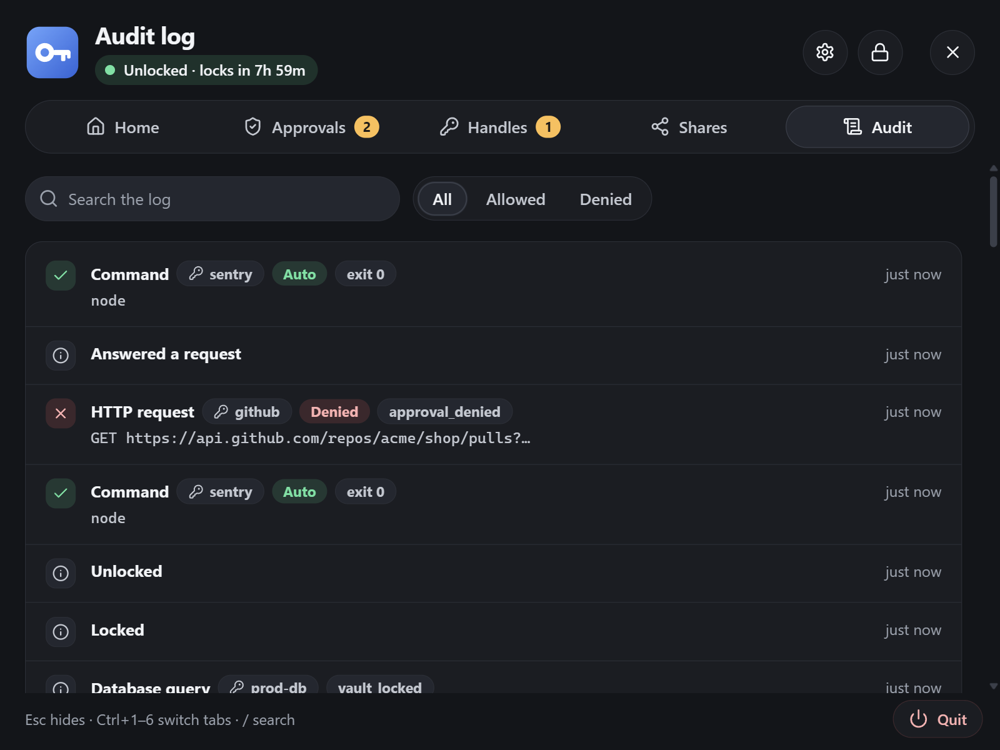
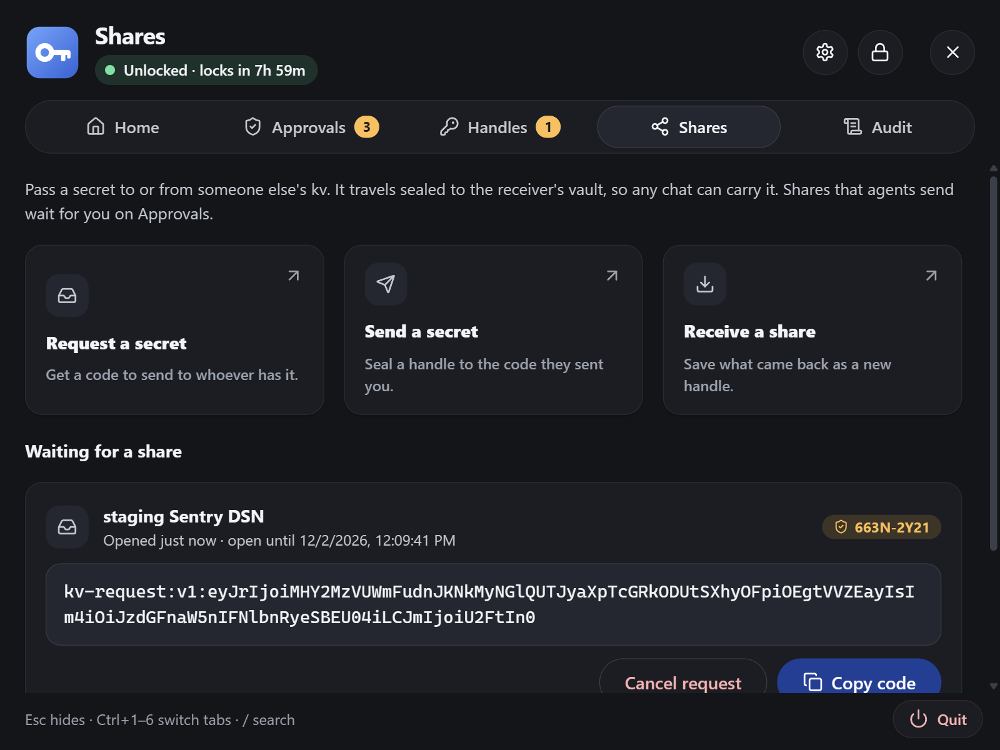

<p align="center">
  
</p>

<h1 align="center">kv</h1>

<p align="center">
  <strong>Let AI coding agents use your API keys, tokens and database passwords<br>
  without ever seeing them.</strong>
</p>

<p align="center">
  <a href="https://github.com/DFanso/key-vault-for-llm/actions/workflows/ci.yml"></a>
  <a href="https://github.com/DFanso/key-vault-for-llm/releases/latest"></a>
  
  <a href="https://modelcontextprotocol.io"></a>
  <a href="#license"></a>
</p>

<p align="center">
  <a href="#install">Install</a> ·
  <a href="#quick-start">Quick start</a> ·
  <a href="#how-it-works">How it works</a> ·
  <a href="#approving-requests">Approving requests</a> ·
  <a href="#documentation">Docs</a>
</p>

<p align="center">
  
</p>

---

## Why kv?

Every usual way of giving an agent a credential leaks it. Paste it into the
chat, put it in a `.env` the agent reads, or write it into an MCP config, and
it ends up in the model's context, in the transcript, and often in logs you
don't control.

kv keeps your secrets in an encrypted vault on your own machine and gives the
agent **handles** instead: names such as `github`, `openrouter` or `prod-db`.
The agent asks kv to make the request, run the program or query the database
with a handle. kv does the authenticated work and hands back the result, with
the secret replaced by `[kv:github]` wherever it would have appeared.

|  | Without kv | With kv |
|---|---|---|
| Where the secret lives | chat, `.env`, MCP config | an encrypted vault on your machine |
| What the agent sees | the real value | a name: `github` |
| What lands in transcripts | the real value | `[kv:github]` |
| Who decides each use | nobody | you, per handle: always, never, or ask me |
| Record of what was done | none | an audit log of every use, without values |

## Highlights

- **Works with any MCP client:** Claude Code, Cursor, Codex, Windsurf, VS Code
  and anything else that speaks MCP over stdio.
- **One vault for every kind of credential:** HTTP APIs, usernames and
  passwords, environment variables for CLIs, Postgres, Redis, files, and MCP
  servers that need a secret of their own.
- **You stay in control:** a handle can ask for your approval on every use,
  from the terminal, the menu bar or a notification. Agents can't add or
  loosen secrets, and every change to the vault asks for your passphrase.
- **Secrets are scrubbed from everything the agent gets back,** including
  their base64, hex, URL-encoded and JSON-escaped forms.
- **Share without pasting:** pass a secret to a colleague's vault through any
  chat, sealed so only their kv can open it.
- **Touch ID and Windows Hello** instead of typing the passphrase.
- **A single binary** with a terminal UI and, on macOS and Windows, a menu bar
  app.

## Install

**macOS and Linux**

```sh
curl --proto '=https' --tlsv1.2 -LsSf https://github.com/DFanso/key-vault-for-llm/releases/latest/download/kv-installer.sh | sh
```

**Windows** (PowerShell)

```powershell
powershell -ExecutionPolicy Bypass -c "irm https://github.com/DFanso/key-vault-for-llm/releases/latest/download/kv-installer.ps1 | iex"
```

Both install `kv` into `~/.cargo/bin`. Check it worked with `kv --version`.

<details>
<summary>Build from source instead</summary>

Clone the repository and run (Rust 1.90 or later):

```sh
cargo install --path crates/kv
```

A kv built from source doesn't update itself; build it again to update.
</details>

## Quick start

**1. Create your vault.** Pick a passphrase; you'll use it to unlock kv.

```sh
kv init
```

**2. Add your secrets as handles.** kv asks for each value in a hidden prompt,
so it never lands in your shell history.

```sh
# An API token, sent only to api.github.com. Each use waits for your OK (mode ask, the default).
kv add github --kind http --host api.github.com

# An API token the agent may use without asking.
kv add openrouter --kind http --host openrouter.ai --mode auto

# A Postgres database the agent can read but not change. kv asks for the postgres:// URL.
kv add prod-db --kind postgres --read-only true

# Environment variables for a CLI, given only to terraform.
kv add aws --kind env --var AWS_ACCESS_KEY_ID --var AWS_SECRET_ACCESS_KEY --cmd terraform
```

Prefer a form? Open kv's window from the menu bar (step 5) and click
**New handle**: it asks what the agent will use the secret for and fills in
the rest. You can also turn a whole `.env` file into one handle with
`kv import .env`.

**3. Connect your agent.** With Claude Code:

```sh
claude mcp add kv -- kv mcp
```

<details>
<summary>Cursor, Windsurf, Claude Desktop, VS Code, Codex and others</summary>

Any client that runs stdio MCP servers works: the command is `kv` with the
argument `mcp`. Most clients take a JSON entry like this one (in Cursor,
`~/.cursor/mcp.json`):

```json
{
  "mcpServers": {
    "kv": { "command": "kv", "args": ["mcp"] }
  }
}
```

VS Code (`.vscode/mcp.json`):

```json
{
  "servers": {
    "kv": { "type": "stdio", "command": "kv", "args": ["mcp"] }
  }
}
```

Codex (`~/.codex/config.toml`):

```toml
[mcp_servers.kv]
command = "kv"
args = ["mcp"]
```

If your client can't find `kv`, use the full path, such as
`~/.cargo/bin/kv`.
</details>

**4. Unlock and go.**

```sh
kv unlock
```

Now ask your agent to use a handle by name, for example *"list the open pull
requests in acme/shop using the github handle"*. There's nothing to start by
hand: kv's background daemon starts on first use, and the vault locks itself
after 8 hours without use.

**5. Keep somewhere to approve requests open.** Handles in `ask` mode wait for
you, so keep one of these running:

```sh
kv tui                  # in a terminal, on any platform
kv tray &               # a menu bar icon on macOS, a notification area icon on Windows
kv tray --login on      # start the icon at every login
```

## How it works



The agent only ever names the handle. kv checks the handle's policy (which
hosts, methods or programs it may be used with), asks you if the handle is in
`ask` mode, does the work, and scrubs the secret out of whatever comes back.

Scrubbing applies to programs too. Here a program the agent ran with the
`sentry` handle printed its token, and this is everything the agent got back:

```json
{
  "type": "exec",
  "exit_code": 0,
  "timed_out": false,
  "stdout": "token: [kv:sentry]\n",
  "stderr": "",
  "truncated": false
}
```

### What the agent can do

These are the tools `kv mcp` gives the agent. None of them returns a secret or
takes one.

| Tool | What it does |
|---|---|
| `list_handles` | Lists handle names, kinds and policies. Never values. |
| `http_request` | Sends an HTTP request with the handle's credential attached. |
| `exec` | Runs a program (never a shell) with the handle's variables, login or file. |
| `db_query` | Runs SQL on Postgres or a command on Redis. |
| `db_connect` | Gives a short-lived local connection URL for tools like `psql` or a migration tool. |
| `list_servers`, `list_server_tools`, `call_server_tool`, `stop_server` | Uses MCP servers that need a secret of their own, such as an SSH or Dokploy server. |
| `request_handle` | Asks you to add a handle it needs. Agents can't add secrets themselves. |
| `request_share`, `send_share`, `receive_share` | Passes a secret to or from someone else's kv. |
| `status` | Says whether the vault is unlocked. |

### Handles

A handle is a named secret plus the rules for using it.

| Kind | Holds | Use it for | The agent uses it through |
|---|---|---|---|
| `http` | a token, and optionally the service's base URL | OpenAI, GitHub, Stripe, any REST API | `http_request` |
| `login` | a username and password | Basic auth, or a CLI that signs in | `http_request`, `exec` |
| `env` | environment variables, and optionally a command that starts an MCP server | `aws`, `terraform`, `npm`, MCP servers | `exec`, the server tools |
| `postgres`, `redis` | a connection URL | queries, migrations, `psql` | `db_query`, `db_connect` |
| `file` | any file up to 1 MiB | key files, service account JSON | `exec` |

Every handle has a **policy**:

- **Mode:** `auto` (use it without asking), `ask` (wait for you; the default)
  or `deny` (never).
- **Hosts and methods** an `http` or `login` handle may be used with.
- **Programs** an `env`, `file` or `login` handle may be given to.
- **Read-only**, for a database handle.

Change it with `kv policy`, `kv tui` or kv's window. Every command that adds,
changes or removes a handle asks for your passphrase (or Touch ID or Windows
Hello), so an agent running commands as you can't loosen anything without you.

When an agent needs a secret you haven't added, it calls `request_handle`.
The request waits at the top of your handles with the name, the hosts and the
agent's reason filled in; you type the value and save.

More in [docs/handles.md](docs/handles.md): keeping a service's address
hidden, logins, MCP servers with secrets, database details and everyday
settings.

## Approving requests

A handle in `ask` mode makes the agent wait, for up to 60 seconds, while kv
shows a desktop notification. Answer in whichever place suits you:

| Where | How |
|---|---|
| **`kv tui`**, in a terminal | `a` allow once · `s` allow for the rest of the agent's session · `d` deny · `D` deny and block the handle |
| **`kv tray`**, the menu bar icon (macOS, Windows) | its menu shows what's waiting; its window does everything the TUI does |
| **The notification** (macOS) | its Allow and Deny buttons |

If an agent finds the vault locked, kv tells you and the call waits 30 seconds
for you to unlock it.


### kv's window

On macOS and Windows, click the key icon for a small menu, then **Open kv**
for the full window: approvals, handles, sharing, the audit log and settings
in one place.

<p align="center">
  
</p>

| | |
|---|---|
|  |  |
| **Home:** what needs you, quick actions and the latest activity. | **Handles:** fill in agents' requests, add, edit, show or remove handles. |
|  |  |
| **New handle:** starts from what the agent will use it for, so you needn't know kv's kinds. | **Audit:** every use of every handle, searchable, without values. |

More in [docs/approvals.md](docs/approvals.md): the TUI's keys, the window,
showing a value, and notification settings (`KV_NOTIFY`, `KV_NOTIFY_SOUND`,
`KV_UNLOCK_WAIT`).

## Sharing a secret

Don't paste a secret into Slack or Telegram for a colleague. Let your vaults
pass it instead:

1. The person who needs it makes a **request code** and posts it in the chat.
   The code holds only a public key.
2. The person who has it answers with a handle. kv seals the value so that
   only the requester's vault can open it, and gives back a **share** to post.
3. The requester's kv opens the share and saves it as a new handle in `ask`
   mode. Nobody's agent sees the value, and the chat only ever sees sealed
   text.

Either side can ask their agent to do it, or use the Shares tab of kv's
window. `.env` files, settings files and binary files can be shared too.

<p align="center">
  
</p>

More in [docs/sharing.md](docs/sharing.md).

## Touch ID and Windows Hello

```sh
kv biometric enable
```

After this, unlocking and changing the vault ask for a fingerprint or Windows
Hello instead of the passphrase. Read [docs/touch-id.md](docs/touch-id.md)
before you use Windows Hello where agents run unattended.

## Cheat sheet

| Command | What it does |
|---|---|
| `kv status` | Is the vault locked? Is Touch ID or Hello on? |
| `kv unlock` / `kv lock` | Let agents use handles / stop them until you unlock |
| `kv list` | Handles and their policies, never values |
| `kv add <name> --kind <kind>` | Add a handle |
| `kv policy <name> ...` | Change a handle's mode, hosts, methods or programs |
| `kv rm <name>` | Remove a handle |
| `kv import .env` | Turn a `.env` or JSON settings file into one handle |
| `kv tui` | Approve requests, manage handles, read the audit log |
| `kv tray` | The menu bar icon and kv's window (macOS, Windows) |
| `kv passwd` | Change the passphrase (also rotates the vault key) |
| `kv update` | Install the latest release |
| `kv stop` | Lock the vault and stop the daemon |

Settings you might want: `KV_IDLE_LOCK=2h` changes when the vault locks
itself, and `KV_HOME` keeps the vault, audit log and sockets in one folder.
See [docs/handles.md](docs/handles.md#day-to-day).

## Updating

`kv update`, or **Update to kv X.Y.Z** in the tray's menu, shows the release
notes, asks, then installs the latest release. kv checks the download's sha256
first and only ever installs from this repository's releases. After an update
the vault is locked, so run `kv unlock`. More in
[docs/updating.md](docs/updating.md), including how to go back to the
previous version.

## Security

kv keeps secrets out of the model's context and transcripts, and limits what
an agent can do with each handle. It is **not a sandbox**: it assumes the agent
runs as you, on your machine.

- The vault is encrypted with XChaCha20-Poly1305 under an Argon2id key derived
  from your passphrase.
- No tool returns a secret or takes one.
- kv's clients check that they're talking to your own kv daemon before they
  send it anything secret.
- A program you let a handle run does get the secret. That's the point, so
  allow only programs you trust.
- An unlocked `kv tui` or `kv tray` answers for whoever drives it, so lock the
  vault, or quit both, when agents run unattended.

Read [docs/security.md](docs/security.md) for the full model and its limits.
To report a vulnerability, use GitHub's private reporting (Security tab, then
Report a vulnerability), not a public issue.

## FAQ

<details>
<summary><strong>Can the agent ever see my secret?</strong></summary>

Not through kv's tools: none returns a value, and secrets are scrubbed from
responses, program output and database results, including their common
encodings. A program you allow a handle to run does receive the secret,
since that's how it uses it, so allow only programs you trust. See
[docs/security.md](docs/security.md) for what kv can and can't stop.
</details>

<details>
<summary><strong>What happens if I don't answer a request?</strong></summary>

After 60 seconds the agent gets `approval_timeout` and nothing is sent. The
audit log records it.
</details>

<details>
<summary><strong>Where does kv keep my data?</strong></summary>

The vault (`vault.kv`) is in your config folder and the audit log
(`audit.jsonl`) in your local data folder, each under `kv`. Set `KV_HOME` to
keep both, and kv's sockets, in one folder of your choosing.
</details>

<details>
<summary><strong>Can I use kv on a server or in CI?</strong></summary>

kv is built for your own machine, with you there to approve. Handles in
`auto` mode work without anyone watching, but read
[docs/security.md](docs/security.md) before you leave agents unattended.
</details>

<details>
<summary><strong>An agent says the vault is locked.</strong></summary>

Run `kv unlock`, or unlock from the tray. The vault locks itself after 8 hours
without use (`KV_IDLE_LOCK` changes that) and after every update.
</details>

## Documentation

| Guide | What's in it |
|---|---|
| [Handles](docs/handles.md) | kinds, policies, hidden addresses, MCP servers, databases, everyday commands |
| [Approving requests](docs/approvals.md) | `kv tui`, `kv tray`, kv's window, notifications |
| [Sharing a secret](docs/sharing.md) | request codes, shares, `.env` and file sharing |
| [Touch ID and Windows Hello](docs/touch-id.md) | unlocking without the passphrase |
| [Updating kv](docs/updating.md) | self-update, upgrade notes, rolling back |
| [Security model](docs/security.md) | what kv protects against, and what it can't |

The screenshots are real captures of kv 1.9.5 on a demo vault, with made-up
handles.

## License

Licensed under either of [Apache License, Version 2.0](LICENSE-APACHE) or
[MIT license](LICENSE-MIT), at your option. Unless you explicitly state
otherwise, any contribution you intentionally submit for inclusion in this
work, as defined in the Apache-2.0 license, is dual licensed as above, without
any additional terms or conditions.
