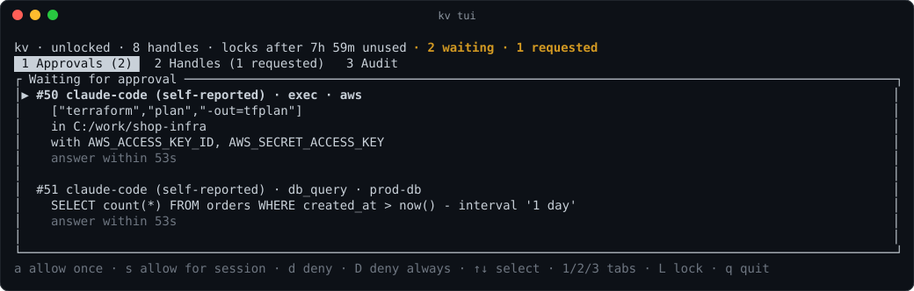

<p align="center">
  
</p>

<h1 align="center">kv</h1>

<p align="center">
  A local secrets broker for AI coding agents.<br>
  Agents use your API keys, tokens and database passwords without ever seeing them.
</p>

<p align="center">
  <a href="https://github.com/DFanso/key-vault-for-llm/actions/workflows/ci.yml"></a>
  <a href="https://github.com/DFanso/key-vault-for-llm/releases/latest"></a>
  
  <a href="https://modelcontextprotocol.io"></a>
  <a href="#license"></a>
</p>

---

When an agent needs a credential, the usual options all leak it. Paste it into
the chat, put it in a `.env` the agent reads, or write it into an MCP config,
and it ends up in the model's context and the transcript.

kv keeps secrets in an encrypted vault on your machine and gives the agent
**handles** instead: names like `github`, `openrouter` or `prod-db`. The agent
asks kv to make the request, run the program or query the database with a
handle. kv does the authenticated work and hands back the result, with the
secret replaced by `[kv:github]` wherever it would have appeared.

- **Works with any MCP client.** Claude Code, Cursor, Codex, Windsurf, VS Code
  and anything else that speaks MCP over stdio.
- **You stay in control.** Handles can ask for your approval on each use, in
  the terminal, from the menu bar, or from a notification.
- **HTTP APIs, programs, Postgres, Redis, files and MCP servers.** One vault
  for every kind of credential an agent needs.
- **Share without pasting.** Pass a secret to a colleague's vault through any
  chat, sealed so only their kv can open it.
- **Touch ID and Windows Hello** instead of typing the passphrase.



## Install

macOS and Linux:

```sh
curl --proto '=https' --tlsv1.2 -LsSf https://github.com/DFanso/key-vault-for-llm/releases/latest/download/kv-installer.sh | sh
```

Windows (PowerShell):

```powershell
powershell -ExecutionPolicy Bypass -c "irm https://github.com/DFanso/key-vault-for-llm/releases/latest/download/kv-installer.ps1 | iex"
```

Both install `kv` into `~/.cargo/bin`. To build from source instead, clone the
repository and run `cargo install --path crates/kv` (Rust 1.90 or later).

## Quick start

**1. Create the vault** and choose a passphrase:

```sh
kv init
```

**2. Add a few handles.** kv prompts for each secret in a hidden field, so it
never lands in your shell history:

```sh
kv add openrouter --kind http --host openrouter.ai --mode auto
kv add github --kind http --host api.github.com          # mode ask: each use waits for you
kv add prod-db --kind postgres --read-only true          # prompts for the postgres:// URL
kv add aws --kind env --var AWS_ACCESS_KEY_ID --var AWS_SECRET_ACCESS_KEY --cmd terraform
```

**3. Connect your agent.** With Claude Code:

```sh
claude mcp add kv -- kv mcp
```

For any other client, add a stdio MCP server whose command is `kv mcp`.

**4. Unlock and go.** Run `kv unlock`, then ask your agent to use a handle by
name. There is nothing to start by hand: the background daemon starts on
first use, and the vault locks itself after 8 hours without use.

To approve requests, keep `kv tui` open in a terminal. On macOS and Windows you
can use the menu bar icon instead: start it with `kv tray &`, and run
`kv tray --login on` to have it start at every login.

## What the agent can do

| Tool | What it does |
|---|---|
| `list_handles` | Lists handle names, kinds and policies. Never values. |
| `http_request` | Sends an HTTP request with the handle's credential attached. |
| `exec` | Runs a program (never a shell) with the handle's variables, login or file. |
| `db_query` | Runs SQL on Postgres or a command on Redis. |
| `db_connect` | Gives a short-lived local connection URL for tools like `psql` or a migration tool. |
| `list_servers`, `call_server_tool`, ... | Uses MCP servers that need a secret of their own, such as an SSH or Dokploy server. |
| `request_handle` | Asks you to add a handle it needs. Agents can't add secrets themselves. |
| `request_share`, `send_share`, `receive_share` | Passes a secret to or from someone else's kv. |
| `status` | Says whether the vault is unlocked. |

Wherever a secret would show up in a response or in program output, the agent
sees `[kv:<handle>]` instead. That includes its base64, hex, URL-encoded and
JSON-escaped forms.

## Handles

| Kind | Holds | Used through |
|---|---|---|
| `http` | a token, and optionally the service's base URL | `http_request` |
| `login` | a username and password | `http_request` (Basic auth), `exec` |
| `env` | environment variables, and optionally a command that starts an MCP server | `exec`, the server tools |
| `postgres`, `redis` | a connection URL | `db_query`, `db_connect` |
| `file` | any file up to 1 MiB | `exec` |

Every handle has a policy:

- **Mode:** `auto`, `ask` (the default) or `deny`.
- **Hosts and methods** an `http` or `login` handle may be used with.
- **Programs** an `env`, `file` or `login` handle may be given to.
- **Read-only**, for a database handle.

Change it with `kv policy`. Every command that adds, changes or removes a
handle asks for your passphrase (or Touch ID or Windows Hello), so an agent
running commands as you can't loosen anything without you.

More in [docs/handles.md](docs/handles.md): hidden service addresses, logins,
MCP servers with secrets, database details, and handle requests from agents.

## Approving requests

A handle in `ask` mode makes the agent wait, for up to 60 seconds, until you
answer. kv shows a desktop notification, and you answer in one of three places:

- **`kv tui`**, in a terminal: `a` allows once, `s` allows for the rest of the
  agent's session, `d` denies, `D` denies and blocks the handle.
- **`kv tray`**, a menu bar icon on macOS and Windows, with a window that does
  everything the TUI does.
- **The notification itself** on macOS, through its Allow and Deny buttons.

If an agent finds the vault locked, kv tells you and the call waits 30 seconds
for you to unlock it.

| | |
|---|---|
|  |  |

More in [docs/approvals.md](docs/approvals.md): the tray, its window,
notifications and their settings (`KV_NOTIFY`, `KV_NOTIFY_SOUND`,
`KV_UNLOCK_WAIT`), and showing a value.

## Sharing a secret

Don't paste a secret into Slack or Telegram for a colleague. Let your agents
pass it between your vaults instead:

1. The person who needs it asks their agent for a **request code** and posts
   it in the chat. The code holds only a public key.
2. The person who has it asks their agent to answer with a handle. kv waits for
   their approval, then gives back a **share** that only the requester's vault
   can open.
3. The requester's agent receives the share, and kv saves it as a new handle.
   Nobody's agent sees the value.

Each side can use the Shares tab of kv's window instead of an agent. `.env`
files, settings files and binary files can be shared too. More in
[docs/sharing.md](docs/sharing.md).

## Touch ID and Windows Hello

```sh
kv biometric enable
```

After this, unlocking and changing the vault ask for a fingerprint or Windows
Hello instead of the passphrase. Read [docs/touch-id.md](docs/touch-id.md)
before you use Windows Hello where agents run unattended.

## Everyday commands

```sh
kv status          # locked or unlocked
kv list            # handles and policies, never values
kv unlock          # agents can use handles again
kv lock            # agents get "vault locked" until you unlock
kv tui             # approve requests, manage handles, read the audit log
kv import .env     # turn a .env or JSON settings file into a handle
kv passwd          # change the passphrase (also rotates the vault key)
kv update          # install the latest release
kv stop            # lock and stop the daemon
```

Every use of a handle is recorded in an audit log, without values. More
commands and settings (`KV_IDLE_LOCK`, `KV_HOME`) are in
[docs/handles.md](docs/handles.md#day-to-day).

## Updating

`kv update`, or **Update to kv X.Y.Z** in the tray's menu, shows the release
notes, asks, then installs the latest release. kv checks the download's sha256
first and only ever installs from this repository's releases. More in
[docs/updating.md](docs/updating.md), including how to go back to the
previous version.

## Security

kv keeps secrets out of the model's context and transcripts, and limits what
an agent can do with each handle. It is **not a sandbox**: it assumes the agent
runs as you, on your machine.

- The vault is encrypted with XChaCha20-Poly1305 under an Argon2id key derived
  from your passphrase.
- No tool returns a secret or takes one.
- kv's clients check that they're talking to your own kv daemon before they
  send it anything secret.
- A program you let a handle run does get the secret. That's the point, so
  allow only programs you trust.

Read [docs/security.md](docs/security.md) for the full model and its limits.
To report a vulnerability, use GitHub's private reporting (Security tab, then
Report a vulnerability), not a public issue.

## Documentation

- [Handles](docs/handles.md): kinds, policies, MCP servers, databases, everyday commands
- [Approving requests](docs/approvals.md): `kv tui`, `kv tray`, notifications
- [Sharing a secret](docs/sharing.md): request codes, shares, `.env` and file sharing
- [Touch ID and Windows Hello](docs/touch-id.md)
- [Updating kv](docs/updating.md): self-update, upgrade notes, rolling back
- [Security model](docs/security.md)

The screenshots are real captures from a demo vault, with made-up handles.

## License

Licensed under either of [Apache License, Version 2.0](LICENSE-APACHE) or
[MIT license](LICENSE-MIT), at your option. Unless you explicitly state
otherwise, any contribution you intentionally submit for inclusion in this
work, as defined in the Apache-2.0 license, is dual licensed as above, without
any additional terms or conditions.
