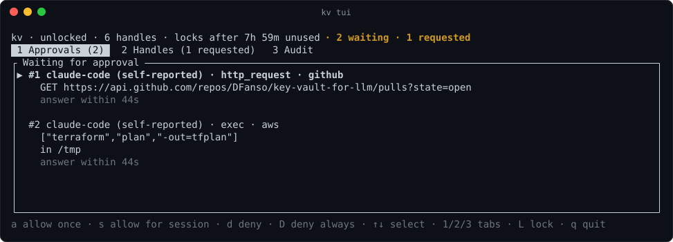
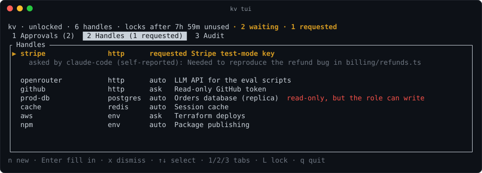
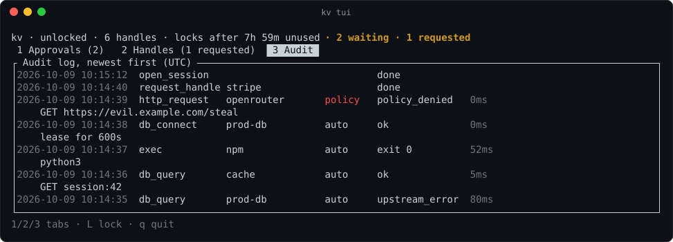
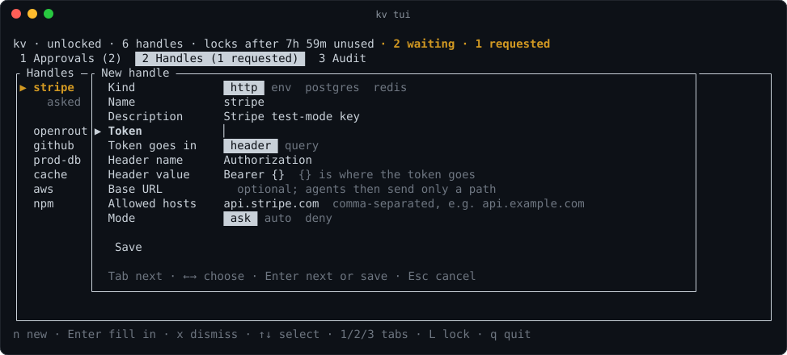

# key-vault-for-llm

[](https://github.com/DFanso/key-vault-for-llm/actions/workflows/ci.yml)
[](https://www.rust-lang.org)
[](https://modelcontextprotocol.io)
[](#what-kv-protects-against)
[](#databases)
[](#license)

A local secrets broker for AI coding agents. Agents get named handles to
secrets (`prod-db`, `openrouter`, `github`) and the broker does the
authenticated work, so API keys, database URLs and other credentials never
show up in a chat transcript or in the model's context.

kv runs as an MCP server (`kv mcp`), so it works with Claude Code, Cursor,
Codex, Windsurf, VS Code and any other client that speaks the Model Context
Protocol over stdio.

Status: agents can make HTTP requests, run programs, and query or connect to
Postgres and Redis with your secrets over MCP, `kv tui` or a menu bar icon
(`kv tray`, with a window of its own) approves `--mode ask` requests as they
arrive, on macOS also from a notification's buttons, and Touch ID or Windows
Hello can stand in for the passphrase.



## Setup

Install a prebuilt binary (macOS, Linux, Windows) into `~/.cargo/bin`:

```sh
curl --proto '=https' --tlsv1.2 -LsSf https://github.com/DFanso/key-vault-for-llm/releases/latest/download/kv-installer.sh | sh
```

```powershell
powershell -ExecutionPolicy Bypass -c "irm https://github.com/DFanso/key-vault-for-llm/releases/latest/download/kv-installer.ps1 | iex"
```

or build it with `cargo install --path crates/kv` (Rust 1.90 or later). Then:

```sh
kv init                       # create the vault and choose a passphrase
kv add openrouter --kind http --host openrouter.ai --mode auto
kv add aws --kind env --var AWS_ACCESS_KEY_ID --var AWS_SECRET_ACCESS_KEY \
  --cmd terraform             # mode ask: each use waits for you in kv tui
kv add prod-db --kind postgres --read-only true   # prompts for the postgres:// URL

claude mcp add kv -- kv mcp   # or add `kv mcp` as a stdio server in any MCP client
```

The agent then sees these tools:

- `list_handles`: names, kinds and policies, never values.
- `http_request`: sends a request with the handle's credential attached.
- `exec`: runs a program (never a shell) with an `env` handle's variables set,
  or with a `file` handle's file written for it to read (see below).
- `db_query`: runs SQL on a `postgres` handle or a command on a `redis`
  handle (see below).
- `db_connect`: a connection URL on this machine for tools that need their own
  connection, such as `psql` or a migration tool (see below).
- `request_handle`: asks you to add a handle it needs (see below).
- `request_share`, `send_share` and `receive_share`: pass a secret to or from
  someone else's kv without it showing up in a chat (see below).
- `status`: whether the vault is unlocked.
- `list_servers`, `list_server_tools`, `call_server_tool` and `stop_server`:
  MCP servers that need your secrets (see below).

Wherever a secret would appear in a response or in program output, the agent
sees `[kv:<handle>]` instead, including base64, hex, URL-encoded and
JSON-escaped forms.

### Keeping a service's address hidden

For self-hosted services such as Dokploy, the address can be as sensitive as
the key. Add the handle with `--base-url` and kv prompts for it; the agent
then sends only paths such as `/project.all`, and the address is scrubbed
from everything it gets back:

```sh
kv add dokploy --kind http --base-url --header x-api-key --template '{}' --mode auto
```

### MCP servers with secrets

Some MCP servers need a secret of their own, such as an SSH password or a
Dokploy API key. Instead of writing it into an MCP config file, make the
server a kv handle: an `env` handle with a `run` command, the exact command
that starts it.

```sh
kv add ssh-dev --kind env --var SSH_MCP_PASSWORD --mode auto \
  --description "dev box over SSH" \
  --run -- /path/to/bunx -y ssh-mcp@1.2.3 --host=10.0.0.5 --user=root
kv add dokploy-prod --kind env --var DOKPLOY_URL --var DOKPLOY_API_KEY \
  --run -- /path/to/bunx -y @dokploy/mcp@0.3.0
```

The agent finds them with `list_servers`, lists a server's tools with
`list_server_tools` (narrow big servers with `filter`) and calls one with
`call_server_tool`. kv starts a server the first time one of its tools is
needed and keeps it for the agent's session; `stop_server` stops it.

- The server runs in your home directory with the handle's variables set.
  What it writes is scrubbed, so results show `[kv:<handle>]` where a secret
  would be.
- Nothing can change the command or its arguments without your passphrase,
  and agents see only the program's name (`runs: bunx`), never the arguments.
- A handle in `--mode ask` waits for you in `kv tui` when the server starts;
  `s` allows it for the rest of that agent session, until the handle's
  `grant_ttl`.
- Locking the vault stops every server; the next call says the vault is
  locked.
- A server that needs no secret, such as one that logs in with a key file,
  can be a handle with a `run` command and no `--var`.
- The server itself holds the secret, so run only programs you trust, and pin
  package versions (`ssh-mcp@1.2.3`), since an unpinned `bunx` command runs
  whatever the registry serves that day.

`kv run <handle>` starts the same command on its own stdin and stdout, for an
MCP client that should talk to one server directly:
`claude mcp add ssh-dev -- kv run ssh-dev`. Change a server's command with
`kv policy <handle> --run -- <command>`.

### Databases

`db_query` opens a connection of its own for each query. Postgres takes one or
more statements and returns one result per statement, every value as text; a
Redis command line such as `HGETALL user:1` returns the reply as JSON. Results
stop at 256 KiB, and a query stops after 30 seconds unless the agent asks for
up to 300. The database's address is scrubbed from results like the password,
unless it is `localhost`. TLS certificates are always checked against the
system's trust store. For Postgres, `sslmode=disable` in the URL turns TLS off,
and a remote server with no `sslmode` in its URL must use TLS; for Redis, use
`rediss://` (kv refuses `#insecure`). A single Postgres row is held in memory
whole before it is cut; a Redis reply is read only as far as the cap.

`db_connect` returns a URL such as
`postgres://kv:<token>@127.0.0.1:41823/app?sslmode=disable` for tools that
need a connection of their own. The URL points at kv, holds a random lease
token instead of the password, and works for 15 minutes unless the agent asks
for up to an hour. kv checks the token, connects to the database with the real
credentials, and passes traffic both ways, scrubbing what comes back as
`db_query` does. When the lease expires, the vault locks or the handle
changes, its connections close. At most 16 leases are open at once, with 16
connections each, and no single message may be larger than 16 MiB. Query
cancellation (Ctrl-C in `psql`) is not passed on, and Redis subscriptions,
`MONITOR` and `CLIENT REPLY` are refused.

With `--read-only true`:

- Redis runs only read commands, such as `GET`, `HGETALL`, `SCAN` and
  `ZRANGE`.
- Postgres sessions start with `default_transaction_read_only=on`, and kv
  refuses queries that mention a way to change that, `DO` blocks, and
  statements that end the transaction (`COMMIT`, `ROLLBACK`, `END`, `ABORT`,
  `CALL`). This is best effort; the real guarantee is a database role that can
  only read. kv checks the role when you `kv add` the handle and on its first
  query after each unlock, and warns (in `kv add`, the query result and the
  Handles tab of `kv tui`) when it can write: when it is a superuser, can
  write server files or run programs, can create in a schema, or can insert,
  update, delete or truncate in any table, view or foreign table, column
  grants included.
- Through `db_connect`, a read-only Postgres session needs PostgreSQL 14 or
  later. kv refuses the same mentions, `DO` and `CALL`, but lets a
  transaction end as the last statement of a query, and passes one query on
  at a time: if the server reports that the session is no longer read-only,
  kv closes it before the next query runs.

## Approving requests

Handles in `--mode ask` (the default) make the agent wait until you answer in
`kv tui` or `kv tray`, for up to 60 seconds. kv also shows a desktop notification; set
`KV_NOTIFY=off` and run `kv stop` to turn that off.

```sh
kv tui
```

Unlock with the passphrase once; the TUI then holds a session token that
works until the vault locks. On the Approvals tab each waiting request shows
the agent's name (as the agent reports it), the tool, the handles and what it
asked for (the first screenshot above):

- `a` allow once
- `s` allow the same handles for this agent session until the handle's
  `grant_ttl` (15 minutes unless set with `kv policy --grant-ttl`)
- `d` deny
- `D` deny, and set the handles to `--mode deny`

The Handles tab adds (`n`), edits (`e`) and removes (`x`) handles and changes
their policy (`p`). Secret values are typed into hidden fields and the TUI
never shows them again (kv's window can, see below); leave one blank when
editing to keep it. Editing an env handle sets
the variables you type over its others and takes out the ones you list under
Remove variables, so you never type the rest again. The Audit tab shows the
newest entries of the audit log. `L` locks the vault, `q` quits.





### From the menu bar

On macOS and Windows, `kv tray` puts a key in the menu bar (the notification
area on Windows) that shows whether the vault is locked and how many
requests are waiting, and answers them from its menu:

```sh
kv tray &                     # or start it at login:
kv tray --login on            # --login off removes the login item
```

Unlock the tray from its menu with Touch ID or Windows Hello (set up with
`kv biometric enable`, below). Without either, or when the prompt is
cancelled, "Unlock…" opens kv's window, which asks for the passphrase. Once
unlocked, each waiting request is an entry with the agent, tool and handles,
and a submenu showing what it asked for and the same four answers as the
TUI: Allow once, Allow for this session, Deny, and Deny and block. "Lock
vault" locks the vault for every client. Anything the menu cannot do, such as
answering a request that has already timed out, shows up as a notification.

On macOS each waiting request also shows up as a notification of its own,
with the agent, tool and handles, and the answers Allow once, Allow for this
session (when the agent named its session) and Deny under its Options
button. Clicking the notification itself opens the request in kv's window.
Once a request is answered anywhere, times out, or the vault locks, its
notification goes. While the tray posts these, the daemon leaves out its own
plain one, so no request shows twice. macOS gives notification buttons only
to an app, so `kv tray` makes `kv.app` from its own binary in kv's data folder
(`~/Library/Application Support/kv/kv.app`), signs it, and runs it beside the
tray as a helper that only posts notifications and passes your answers back; it
holds no secret or session. The tray makes `kv.app` afresh each time it starts
and never reuses the one there: that folder is writable by any program running
as you, and a changed copy could answer requests for you. For the same reason
`kv.app` started any other way does nothing. The Allow buttons work only while
the Mac is unlocked. If the tray or its helper stops, the daemon posts its
plain notifications again within about 5 seconds; a request that arrives in
those seconds gets none, though it still waits for you.
The tray itself stays the `kv` you installed, which Touch ID and the keychain
know. The first time, macOS asks whether kv may send notifications; turn them
on later in System Settings, Notifications, kv, where choosing the Alerts style
keeps each one on screen until you answer it. `KV_TRAY_APP=off kv tray` leaves
`kv.app` out, with plain notifications.

Clicking the icon opens a small menu beside it, like a flyout: what is
waiting, then Open kv, Lock kv (or Unlock), Start at login and Quit kv tray.
The system menu is on the other button. A second click, Esc, or clicking
elsewhere hides it again. Open kv, or "Open kv…" in the system menu, opens
kv's window. The window does everything `kv tui`
does without a terminal: Home shows what is waiting, your handles and shares,
and the latest activity, with quick actions; Approvals has each waiting
request in full; Handles is where you fill in agents' handle requests and
add, edit, re-police, show or remove handles; then Shares (see sharing, below),
Audit, and Settings, which picks a light or dark look (or follows the
system), turns the login item on or off, locks the vault and quits the tray.
The menu and the window share one session; hiding the window keeps it, and
Lock (in either) ends it. kv's window only opens from the tray icon or its
menu. Treat a kv window that appears on its own, asking for your passphrase,
as fake. On Windows the window needs the Microsoft Edge WebView2 Runtime,
which Windows 10 and 11 normally have.

The window has no frame, so it opens beside the icon like the menu and hides
when you click elsewhere, with three exceptions. Drag it by its title bar and
it is yours: it stays where you put it, above other windows, until you hide it
with the close button, Esc or the icon. It also stays up while a form or any
other dialog is open, and while the system's file panel is open (Add file,
Import file), so neither is lost when the focus moves. A value on show is the
exception: it is put away whenever the window loses the focus, even where the
window stays up. The small menu is always a flyout: if the window is hidden in the middle of a form, the form is
cancelled when the menu opens, not left inside it.

The login item takes effect at your next login. On Windows a console window
may flash as it starts.

The eye on each row of the Handles screen shows that handle's value: the
token and base URL, the database URL, each variable of an env handle, or what
a file is (with its text, for a text file up to 64 KiB). kv asks every time,
however long ago you unlocked it: Touch ID (whose prompt also takes your
Mac's login password) or Windows Hello where you set it up, or else the kv
passphrase, which the daemon checks again; wrong ones count toward the same
backoff as unlocking. Each showing is in the audit log, by handle, never with
the value. The value goes after a minute, when you hide it, or when the
window loses the focus or the vault locks. There is no Copy button, since any
program, an agent's too, can read the clipboard: select the text and copy it
yourself if you need to.

### When the agent needs a key you have not added

Agents cannot add secrets: no tool takes a value. Instead an agent calls
`request_handle` with what it knows (the name, the kind, where the token goes,
the hosts or commands, and why it wants it), and kv shows a notification. The
request waits at the top of the Handles tab. `Enter` opens the New handle form
already filled in with the focus on the secret: type or paste it, add the base
URL if the agent asked for one, check the hosts (at most 4, in plain ASCII) and
save. Programs an `env` handle may run are shown as a hint rather than filled
in, since one could be a shell; type the ones you allow. `x` dismisses the
request. At most 16 wait at once; they survive a lock but not a daemon restart.



## Sharing a secret with someone else

When a colleague needs one of your secrets, or you need one of theirs, don't
paste it into Telegram or Slack, where anyone who gets into the chat can
read it. Let both agents pass it between the two vaults instead:

1. The person who needs it asks their agent. It calls `request_share` and
   gets a request code (`kv-request:v1:…`) to post in the chat. The code
   holds only a public key; the private half stays in their vault.
2. The person who has it asks their agent to answer. It calls `send_share`
   with the code and a handle, and kv waits for that person to approve on
   the Approvals tab, every time, whatever the handle's mode. Once they
   allow it, the agent gets a share (`kv-share:v1:…`) to post back: the
   handle's value, sealed so that only the requesting vault can open it
   (X25519, HKDF-SHA256 and XChaCha20-Poly1305).
3. The requester's agent calls `receive_share`. kv opens the share and saves
   it as a new handle. The agent sees the handle's name and policy, never
   the value.

A received handle starts in ask mode and keeps only the hosts, methods and
read-only setting it was sent with, never a `run` command or programs it may
be given to. Add those with Policy if it needs them. A share never replaces a
handle: pick another name if the suggested one is taken. Each request answers
one share and expires after 7 days.

kv refuses a share that sets environment variables which change how a program
runs or where it connects, such as `PATH`, `LD_PRELOAD`, `DYLD_*`,
`NODE_OPTIONS`, `GIT_SSH_COMMAND`, package-manager settings (`npm_config_*`,
`PIP_*`, `UV_*`) or `*_PROXY`: every program kv starts with the handle would
get them. It won't send a handle that sets them either. A handle you add
yourself may set them, with a warning. A handle kv saved from a share that
sets one, such as one received by an older kv, starts no program until you
take those variables out of it (Edit, then Remove variables, which needs none
of its values) or add it again as your own; forgetting the share on the
Shares tab doesn't change that.

kv also refuses a value, token or URL longer than 4096 bytes, an env handle
with more than 8 KiB of values, and a value that would take the whole vault
past what kv's output scrubber takes: about 256 KiB of ordinary tokens, less
of values full of punctuation, whose encodings it also looks for. A change
that makes the vault smaller always goes through. These limits are checked
whenever a value is saved (add, update, a share sent or received), not when
a vault is opened or a program starts, so a handle saved by an older kv keeps
working; you can only change its value to one within them.

You don't need an agent for any of it. The same three steps are buttons on the
Shares tab of kv's window, and each shows its code or share with a Copy
button, ready to paste into whatever chat you use:

1. **Request a secret** makes the request code. Say what you need and who you
   are if you like; both go in the code, which anyone in the chat can read.
2. **Send a secret**: paste their request code and pick a handle. kv seals it
   at once, without the Approvals tab, since you are the one asking. kv
   doesn't keep the sealed text, so copy it before you close the dialog. A
   handle set to deny can't be sent.
3. **Receive a share**: paste the share they sent back, and a name to save it
   under if the suggested one is taken.

Either side can use an agent or the window; the codes are the same.

The Shares tab also lists open requests (with their codes and a Copy button),
what you received and what you sent. **View** shows a received value as long
as the handle still holds what arrived, never a value you typed in yourself.
**Cancel request** throws away a request's key, so a share sealed to it can no
longer be opened.

Anyone who can read the chat can seal something to a request code, so kv
cannot tell who a share came from; the sender's name is whatever they typed.
Each request has a safety code such as `7KQ2-M9XD`, shown to both people: the
requester when the code is made, the sender on the approval or with the sealed
share. For anything sensitive, compare the two over a call or another channel
before you send the share or use the handle.

A share of a token, or of an env handle with a few variables, fits in one
chat message. When a share is longer than one Telegram message, kv says so:
send it as a text file rather than splitting it.

### Sharing the variables of a `.env` or settings file

To pass on what a project's `.env` or JSON settings file holds, import it
into a handle, then share that handle as above:

```sh
kv import .env                      # tick the variables to keep, then save
kv import appsettings.Development.json --name demo-app
kv import .env --keep API_TOKEN,DB_URL --yes
```

kv reads the file, lists the variables it found by name (never their
values) and saves the ones you tick as one env handle, in ask mode unless
you pass `--mode`. It asks for your passphrase or Touch ID as `kv add` does.
A JSON file's nested keys become names joined with `__`, as .NET reads them
(`ConnectionStrings__Db`).
Variables that change how a program runs or where it connects, such as
`PATH` or `NODE_OPTIONS`, start unticked; kv will not send them in a share
anyway. `kv import` notes what it skipped or could not read, such as `${VAR}`
references, which it keeps as written. On the Handles tab, **Import file**
does the same in the window (on a Mac, press Command-Shift-Period in the file
panel to see `.env`).

Don't share a handle made from a settings file such as `appsettings.json`
yet. Besides secrets, those files set addresses (a database host, an API's
base URL), and kv cannot yet show the receiver a code for what a share
holds: someone who forges a share could point their app at a server of
theirs. The same goes for a `.env` variable that holds an address, such as
`DATABASE_URL`. Tokens and passwords are fine to share, with the safety code
checked as above.

### Sharing any file

A `file` handle keeps any file as it is, up to 1 MiB: a list of passwords, a
key, a certificate, a keystore. kv stores the bytes, never reads them as
text, and never shows them to an agent.

```sh
kv add passwords --kind file --file ./passwords.txt --cmd hydra --mode ask
```

A program uses the file through `exec`. List the handle with the others, and
put `{file:passwords}` in an argument where the file's path goes (or read the
path from `KV_FILE_PASSWORDS`). kv writes the file to a folder only you can
read, under its own name, and removes it when the program ends. If the file
is text, each line of eight characters or more is scrubbed from the program's
output like any other secret; a binary file is not scrubbed, and `kv add`
says so. A text file whose lines add up to more than the scrubber takes
(about 250 KiB of text) is refused for the same reason.

Sharing works as above, with two differences. The sealed share of a file is
too long for a chat message, so `send_share` saves it as a `.kvshare` file
and gives the agent its path to send as an attachment (with Telegram,
`telegram_send_file`). The person's agent passes the path it saved the
attachment to as `receive_share`'s `file`. The file is encrypted to the
receiver's vault and nobody else's, and it arrives byte for byte or not at
all: the share carries the file's SHA-256, which the receiver's kv checks
before saving, on top of the encryption refusing anything changed on the
way. Your approval names the file, its size and a short fingerprint, so you
can read it out to the receiver to confirm it is the same one. A received
file starts in ask mode, like any share.

The window does the same without the terminal. On the Handles screen, **Add
file** picks a file and asks for a name and the programs that may use it. When
you send a file on the Shares screen, kv saves the sealed share as a
`.kvshare` file in your Downloads folder and offers **Show in folder**; to
receive one, choose it with **Choose a .kvshare file** in the Receive dialog.
The download icon beside a received file saves it to Downloads exactly as it
arrived, under a name that is safe to create, and never over a file already
there.

## Day to day

```sh
kv list                       # names and policies, never values
kv policy openrouter --method GET --method POST
kv lock                       # agents get "vault locked" until you unlock
kv unlock
kv passwd                     # also rotates the vault key
kv stop                       # lock and stop the daemon
```

Secret values and passphrases are read from a hidden prompt, or one per line
from stdin when stdin is not a terminal. They are never taken as command-line
arguments, where they would end up in shell history.

`--method` limits also refuse method-override headers such as
`X-HTTP-Method-Override`, but kv cannot see a `_method` field inside a request
body, so for a strictly read-only key prefer one the service itself limits.

Every command that changes the vault asks for the passphrase (or Touch ID
or Windows Hello, below), or runs inside an unlocked `kv tui`, so an agent
running commands as you cannot add, remove or loosen secrets without you. The vault locks
itself after 8 hours without use. To change that, set `KV_IDLE_LOCK=2h` (any
duration) in your shell profile and run `kv stop` so the next command picks it
up.

`exec` looks bare program names up on the PATH the daemon started with,
skipping relative entries. Anything that can write to a directory on that
PATH can stand in for the program, so for the strongest guarantee list
programs by absolute path (`--cmd /usr/local/bin/terraform`).

Set `KV_HOME` to keep the vault, audit log and sockets in one directory
instead of the platform defaults. Every use of a handle is recorded in the
audit log (`audit.jsonl`), without values.

## Touch ID and Windows Hello

```sh
kv biometric enable           # asks for the passphrase, then a fingerprint or Hello
kv biometric disable
```

Once it is on, `kv unlock`, `kv add`, `kv rm`, `kv policy` and `kv tui` ask
for a fingerprint or Hello instead of the passphrase (Ctrl-T asks again on
the TUI's unlock screen). Cancel the prompt to type the passphrase instead;
commands that read stdin from a pipe always read the passphrase. `kv status`
says which is on. `kv passwd` turns it off, since the new vault key has no
copy for the device; run `kv biometric enable` again. Adding or removing a
fingerprint on the Mac also turns Touch ID off until you enable it again.

kv keeps the Touch ID key in your login keychain, where only the `kv` binary
that saved it can read it without your login password. After you install a
new kv, macOS asks for that password once; choose Always Allow. Set
`KV_BIOMETRIC=off` to never use either method.

An agent running commands as you can start a prompt too, by running one of
these commands itself. The Touch ID prompt says what kv is trying to do,
such as "remove the handle prod-db from the kv vault" or "open kv tui, where
you approve agent requests": cancel any you did not start. kv sends the key
only to a daemon running the same `kv` program. Windows Hello's dialog
cannot say what it is for, and Windows does not keep other programs from
using kv's Hello credential, so a Hello prompt you approve for another
program can give it a lasting key to the vault. On Windows, cancel every
Hello prompt you did not start, and keep using the passphrase where agents
run unattended.

## What kv protects against

kv keeps secrets out of the model's context and transcripts, and limits what
an agent can do with a handle through per-secret policy and approvals. It is
not a sandbox: a malicious process running as your own user can still attack
it (for example by reading process memory on platforms that allow it). A
program you let a handle run does receive the secret.

An unlocked `kv tui` or `kv tray` answers requests for whoever drives it. A
program running as you that can control other programs' windows can type
into the TUI or click Allow in the tray's menu, window or notifications: on macOS only
programs you have given the Accessibility permission, on Windows any program
at the same integrity level. Lock the vault, or quit both, when agents run
unattended. Likewise, while kv's window shows a value, a program you have
given the Screen Recording or Accessibility permission can read it off the
screen.

Single-user, for macOS, Linux and Windows, written in Rust.

The screenshots are real `kv tui` captures from a demo vault, with made-up
handles.

## License

Licensed under either of [Apache License, Version 2.0](LICENSE-APACHE) or
[MIT license](LICENSE-MIT), at your option. Unless you explicitly state
otherwise, any contribution you intentionally submit for inclusion in this
work, as defined in the Apache-2.0 license, is dual licensed as above, without
any additional terms or conditions.
