# Approving requests

Handles in `--mode ask` (the default) make the agent wait until you answer in
`kv tui` or `kv tray`, for up to 60 seconds. kv also shows a desktop
notification with a sound (see [Notification settings](#notification-settings) to change
what it tells you about).

## In the terminal: kv tui

```sh
kv tui
```

Unlock with the passphrase once; the TUI then holds a session token that
works until the vault locks. On the Approvals tab each waiting request shows
the agent's name (as the agent reports it), the tool, the handles and what it
asked for:

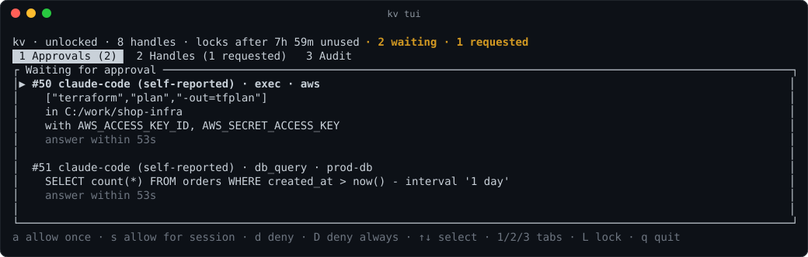

- `a` allow once
- `s` allow the same handles for this agent session until the handle's
  `grant_ttl` (15 minutes unless set with `kv policy --grant-ttl`)
- `d` deny
- `D` deny, and set the handles to `--mode deny`

An `http_request` shows its method and URL, the names of the extra headers
the agent set (not their values), and its body: the size in bytes and the
first 200 characters. Agent text is cut at 300 characters in `kv tui` and
kv's window. A request whose URL, header names, command, query or working
directory had to be cut there can only be allowed once: `s` is not offered,
since allowing it for the session would let more requests like it through
unread. A body longer than its preview does not count, since its size is
shown. The tray's menu and notifications show less of the request; open
kv's window to read it in full before you allow it for the session.

The Handles tab adds (`n`), edits (`e`) and removes (`x`) handles and changes
their policy (`p`). Secret values are typed into hidden fields and the TUI
never shows them again (kv's window can, see below); leave one blank when
editing to keep it. Editing an env handle sets
the variables you type over its others and takes out the ones you list under
Remove variables, so you never type the rest again. The Audit tab shows the
newest entries of the audit log. `L` locks the vault, `q` quits.

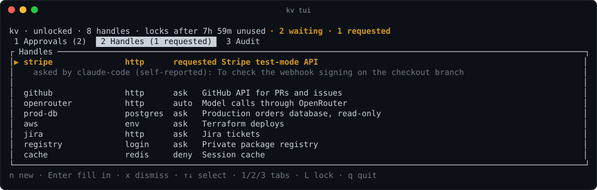

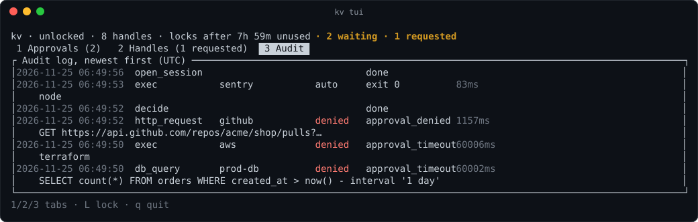

## From the menu bar

On macOS and Windows, `kv tray` puts a key in the menu bar (the notification
area on Windows) that shows whether the vault is locked and how many
requests are waiting, and answers them from its menu:

```sh
kv tray &                     # or start it at login:
kv tray --login on            # --login off removes the login item
```

Unlock the tray from its menu with Touch ID or Windows Hello (set up with
`kv biometric enable`, see [Touch ID and Windows Hello](touch-id.md)). Without either, or when the prompt is
cancelled, "Unlock…" opens kv's window, which asks for the passphrase. Once
unlocked, each waiting request is an entry with the agent, tool and handles,
and a submenu showing what it asked for and the same four answers as the
TUI: Allow once, Allow for this session, Deny, and Deny and block. "Lock
vault" locks the vault for every client. Anything the menu cannot do, such as
answering a request that has already timed out, shows up as a notification.

### Notifications on macOS

Each waiting request also shows up as a notification of its own,
with the agent, tool and handles, and the answers Allow once, Allow for this
session (when the agent named its session) and Deny under its Options
button. Clicking the notification itself opens the request in kv's window.
Once a request is answered anywhere, times out, or the vault locks, its
notification goes. While the tray posts these, the daemon leaves out its own
plain one, so no request shows twice. macOS gives notification buttons only
to an app, so `kv tray` makes `kv.app` from its own binary in kv's data folder
(`~/Library/Application Support/kv/kv.app`), signs it, and runs it beside the
tray as a helper that only posts notifications and passes your answers back; it
holds no secret or session. The tray makes `kv.app` afresh each time it starts
and never reuses the one there: that folder is writable by any program running
as you, and a changed copy could answer requests for you. For the same reason
`kv.app` started any other way does nothing. The Allow buttons work only while
the Mac is unlocked. If the tray or its helper stops, the daemon posts its
plain notifications again within about 5 seconds; a request that arrives in
those seconds gets none, though it still waits for you.
The tray itself stays the `kv` you installed, which Touch ID and the keychain
know. The first time, macOS asks whether kv may send notifications; turn them
on later in System Settings, Notifications, kv, where choosing the Alerts style
keeps each one on screen until you answer it. `KV_TRAY_APP=off kv tray` leaves
`kv.app` out, with plain notifications.

The tray posts kv's other notices through `kv.app` too, locked or not, each
with a button that acts on it:

- "unlock needed" has Unlock, which does what the menu's Unlock does: Touch
  ID where it is set up, otherwise kv's window asks for the passphrase. The
  notification goes once the vault is unlocked, wherever it was unlocked.
- "still waiting" brings the request's own notification back, with its
  answers.
- "requests timed out", "handle requested" and "shared secret received"
  have Open kv, which opens kv's window on the Audit, Handles or Shares tab.

Clicking a notification does what its button does. While the tray takes these
from the daemon (it asks every second), the daemon posts none of them
itself; if the tray stops, the daemon posts what is left within about 5
seconds. Without the tray, the daemon's own notifications come from the
`kv` binary, which is not an app, so macOS files them under **Finder**: if
you see none, check System Settings, Notifications, Finder.

### kv's window

Clicking the icon opens a small menu beside it, like a flyout: what is
waiting, then Open kv, Lock kv (or Unlock), Start at login and Quit kv tray.
The system menu is on the other button. A second click, Esc, or clicking
elsewhere hides it again. Open kv, or "Open kv…" in the system menu, opens
kv's window. The window does everything `kv tui`
does without a terminal: Home shows what is waiting, your handles and shares,
and the latest activity, with quick actions; Approvals has each waiting
request in full; Handles is where you fill in agents' handle requests and
add, edit, re-police, show or remove handles (each handle's ⋯ menu holds Show
value, Edit, Access policy and Remove, and Edit can also show and copy the
current value after the same confirmation; New handle starts by asking what
the agent will use the secret for: a web API, signing in with a username and
password, a program or CLI, a Postgres or Redis database, or a file, so you
need not know kv's kinds); then Shares (see [Sharing](sharing.md)),
Audit, and Settings, which picks a light or dark look (or follows the
system), turns the login item on or off, locks the vault and quits the tray.
The menu and the window share one session; hiding the window keeps it, and
Lock (in either) ends it. kv's window only opens from the tray icon or its
menu. Treat a kv window that appears on its own, asking for your passphrase,
as fake. On Windows the window needs the Microsoft Edge WebView2 Runtime,
which Windows 10 and 11 normally have.

<p align="center">
  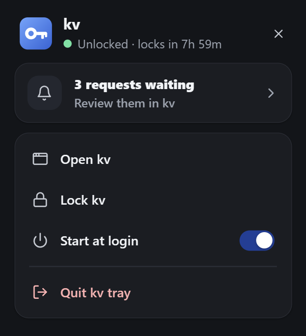
</p>

| | |
|---|---|
| 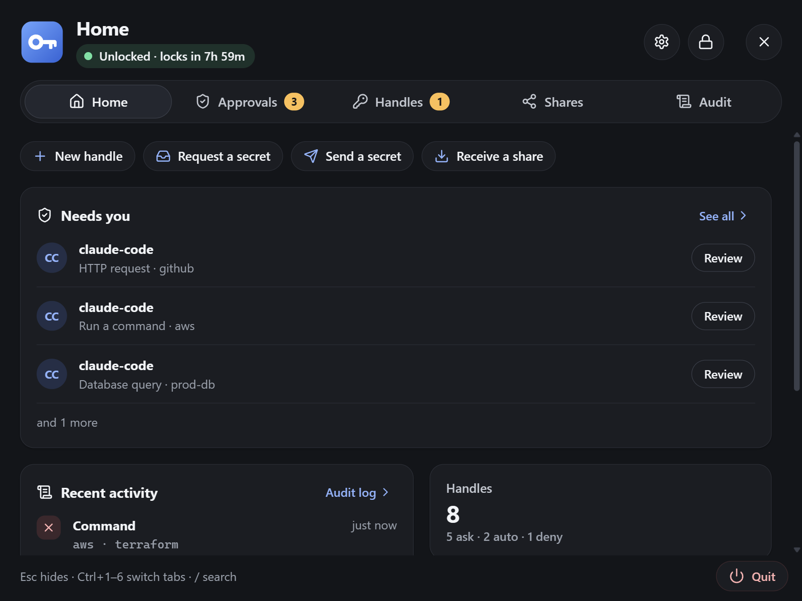 | 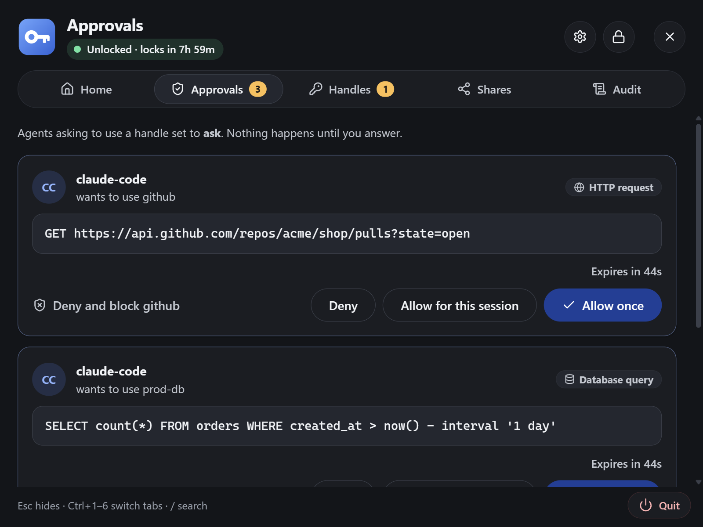 |
| 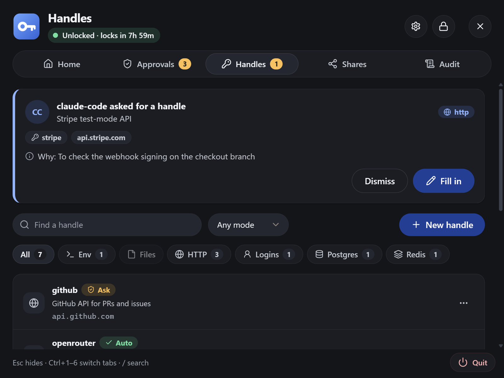 | 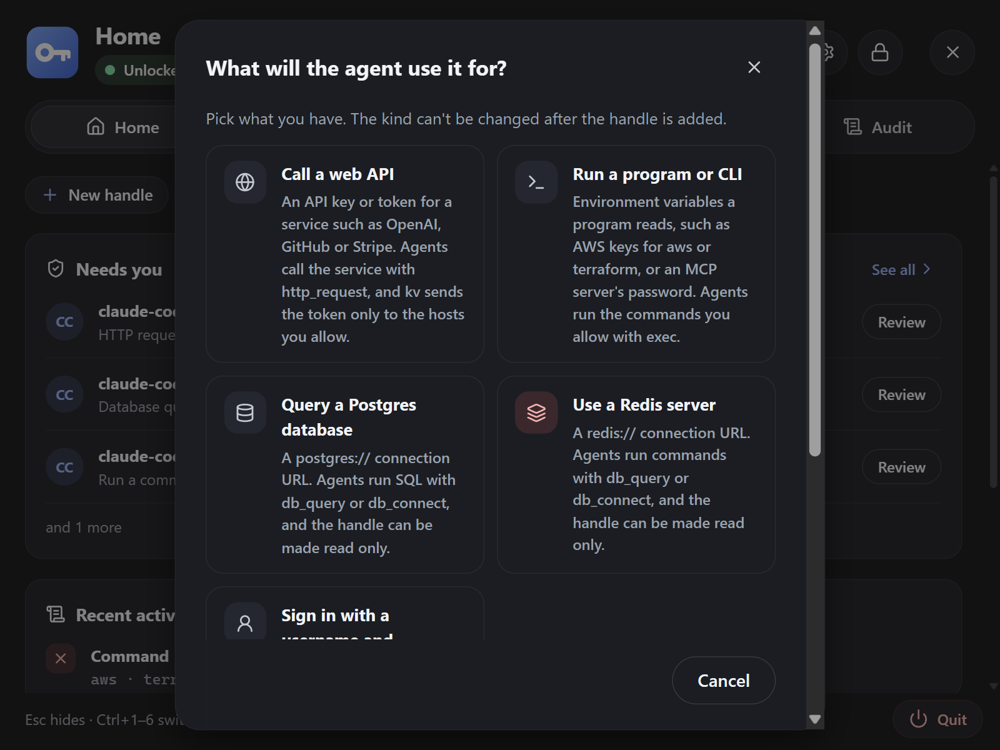 |
| 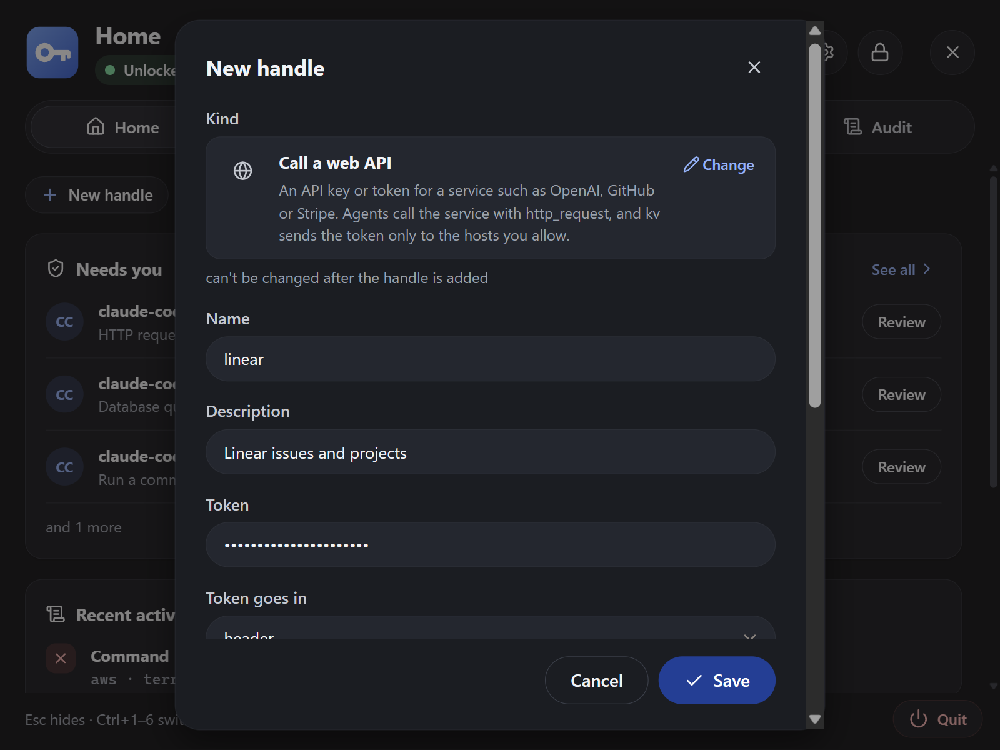 | 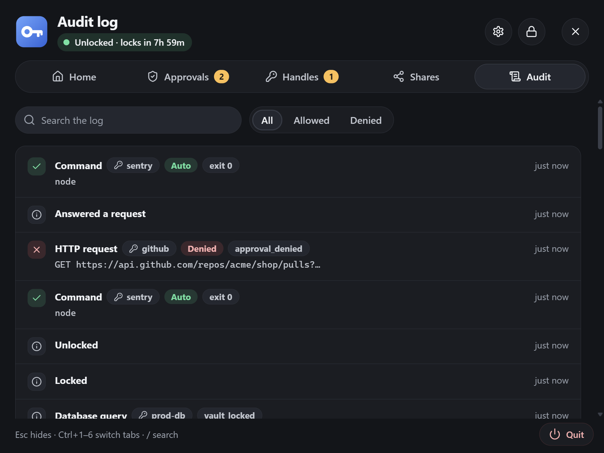 |
| 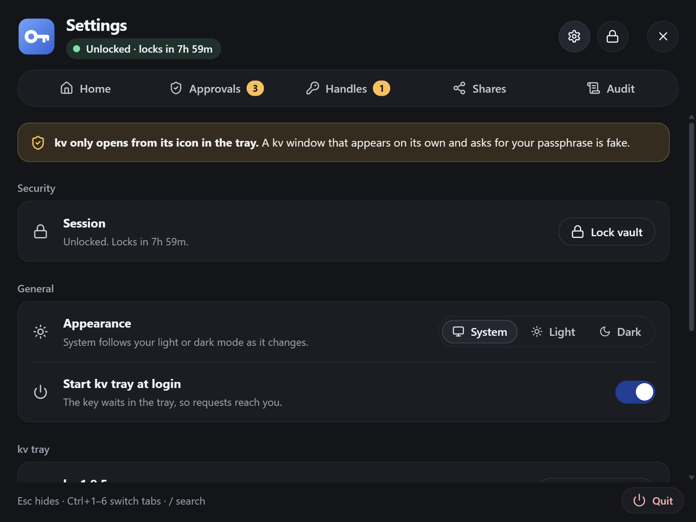 | 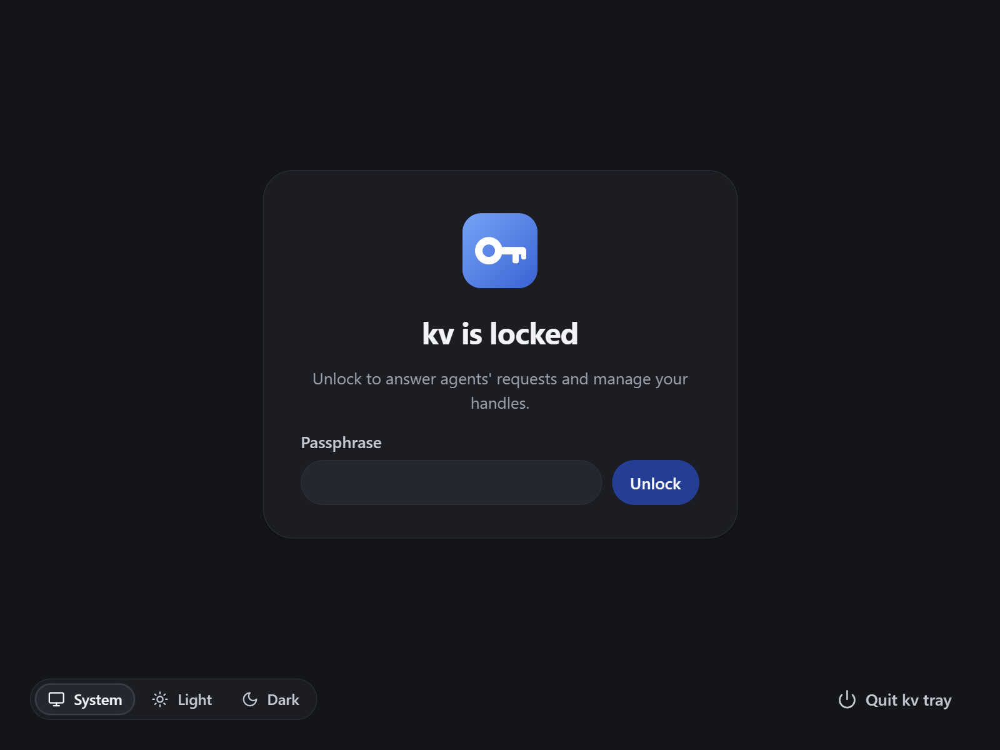 |

The window has no frame, so it opens beside the icon like the menu and hides
when you click elsewhere, with three exceptions. Drag it by its title bar and
it is yours: it stays where you put it, above other windows, until you hide it
with the close button, Esc or the icon. It also stays up while a form or any
other dialog is open, and while the system's file panel is open (New handle's
file cards), so neither is lost when the focus moves. A value on show is the
exception: it is put away whenever the window loses the focus, even where the
window stays up. The small menu is always a flyout: if the window is hidden
in the middle of a form, the form is cancelled when the menu opens, not left
inside it.

The login item takes effect at your next login. On Windows a console window
may flash as it starts.

### Showing a value

The eye on each row of the Handles screen shows that handle's value: the
token and base URL, the database URL, each variable of an env handle, or what
a file is (with its text, for a text file up to 64 KiB). kv asks every time,
however long ago you unlocked it: Touch ID (whose prompt also takes your
Mac's login password) or Windows Hello where you set it up, or else the kv
passphrase, which the daemon checks again; wrong ones count toward the same
backoff as unlocking. Each showing is in the audit log, by handle, never with
the value. The value goes after a minute, when you hide it, or when the
window loses the focus or the vault locks. Each value has a Copy button. On
Windows kv keeps the copy out of clipboard history (Win+V) and the cloud
clipboard, and clears the clipboard after 20 seconds unless you copied
something else since. On macOS the copy stays until you replace it. While the
value is on the clipboard, any program, an agent's too, can read it.

## Notification settings

Three settings change what kv tells you about. Set them in your shell
profile (on Windows as user environment variables, such as
`setx KV_NOTIFY all`, so a `kv tray` started at login sees them too) and run
`kv stop` so the next command picks them up:

- `KV_NOTIFY`: `ask` (the default) for requests waiting for you, handles an
  agent asks you to add, and secrets shared with you; `all` for those and also
  each handle an agent uses without asking you (mode `auto`, or allowed for
  the session), once per handle per agent session; `off` for none.
- `KV_NOTIFY_SOUND`: `alarm` (the default) plays a louder sound for requests
  waiting for you and the usual one for the rest, `default` plays the usual
  one for all, and `off` plays none. On Windows a request waiting for you
  stays on screen until you dismiss it.
- `KV_UNLOCK_WAIT`: how long an agent's call waits for you to unlock a locked
  vault before it fails with `vault_locked`: `30s` (the default), any
  duration up to `10m`, or `0` or `off` to fail at once, as kv did before
  this setting. With `KV_NOTIFY=off` calls never wait, since nothing would tell you
  why they hang.

At most 10 requests and 10 uses a minute get a notification each; the next
one says how many were held back, and every waiting request is still in
kv's window and `kv tui`. A value kv does not understand counts as the
default, so a typo cannot keep the daemon from starting.

### When something waits on you

With `KV_NOTIFY` at `ask` or `all`, kv also tells you when an agent is stuck
on you, not only when a request first arrives:

- **Unlock needed.** An agent's call (an HTTP request, a command, a query, a
  lease, a run or a share; not the status or the list of handles) found the
  vault locked: "claude-code is waiting (http_request): unlock kv." The first
  such call after the vault locks is told at once, later ones at most every
  10 minutes with a count of the calls since. The call then waits for
  `KV_UNLOCK_WAIT` (30 seconds by default): unlock in time (`kv unlock`, kv's
  window, or the notification's Unlock button under kv tray) and it goes on
  as if the vault had been unlocked all along, approval included; otherwise
  it fails with `vault_locked` as before. At most 32 calls wait at once;
  past that, they fail at once. Your MCP client has its own timeout for a
  tool call, and one shorter than `KV_UNLOCK_WAIT` gives up first: the agent
  then sees that timeout rather than `vault_locked`, and can simply call
  again once you have unlocked.
- **Still waiting.** A request nobody has answered halfway through its 60
  seconds is shown again, "About 30 s left." It counts against the same 10
  a minute as new requests.
- **Requests timed out.** Requests that timed out unanswered are told of
  together: the first one starts a 10-second gather, then one notification
  names them all ("You missed 3 requests (claude-code: github, prod-db;
  cursor: openrouter)."), and later ones wait at least 5 minutes for the next.
  The Audit tab lists each with `approval_timeout`.
