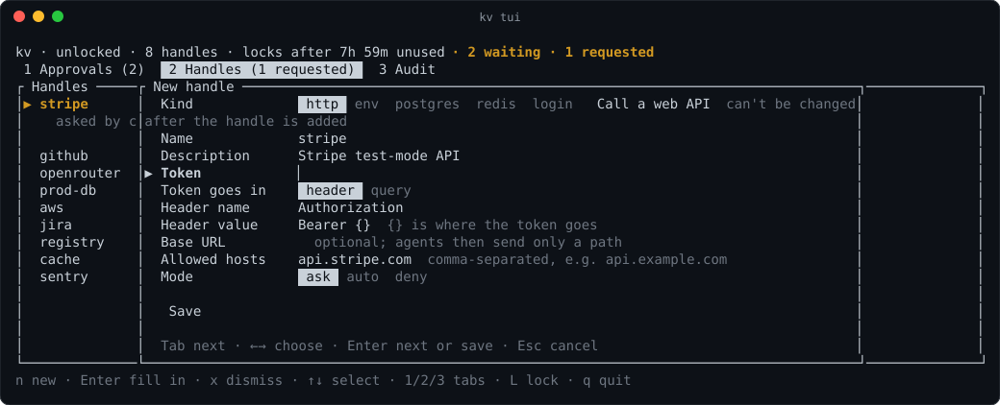

# Handles

A handle is a named secret plus the rules for using it. Agents see the name and the rules, never the value.

## Kinds of handles

| Kind | Holds | The agent uses it through |
|---|---|---|
| `http` | a token, and optionally the service's base URL | `http_request` |
| `login` | a username and password | `http_request` (Basic auth), `exec` |
| `env` | environment variables, and optionally a command that starts an MCP server | `exec`, the server tools |
| `postgres`, `redis` | a connection URL | `db_query`, `db_connect` |
| `file` | any file up to 1 MiB | `exec` |

Every handle has a policy: its mode (`auto`, `ask` or `deny`; `ask` by
default), the hosts and methods an `http` or `login` handle may be used
with, the programs an `env`, `file` or `login` handle may be given to, and
whether a database handle is read-only. Change it with `kv policy`.

## Keeping a service's address hidden

For self-hosted services such as Dokploy, the address can be as sensitive as
the key. Add the handle with `--base-url` and kv prompts for it; the agent
then sends only paths such as `/project.all`, and the address is scrubbed
from everything it gets back:

```sh
kv add dokploy --kind http --base-url --header x-api-key --template '{}' --mode auto
```

## Usernames and passwords

A `login` handle keeps a username and password together, such as a service
account's sign-in. The agent never sees either; kv uses them in two ways:

- `http_request` sends them as HTTP Basic auth (`Authorization: Basic ...`),
  only to the hosts you allow with `--host`.
- `exec` gives them to the programs you allow with `--cmd`, as
  `<NAME>_USERNAME` and `<NAME>_PASSWORD`: `JIRA_USERNAME` and `JIRA_PASSWORD`
  for a handle named `jira` (a name that starts with a digit gets `KV_` in
  front). `list_handles` tells the agent both names.

```sh
kv add jira --kind login --host jira.example.com --cmd curl
```

The username, the password and the Basic auth value made from them are all
scrubbed from what the agent gets back. A username cannot contain a colon,
since Basic auth ends the username at the first one. To change one half,
edit the handle in the window or `kv tui` and leave the other blank: it
keeps its value. A login can be shared like any handle (see [Sharing](sharing.md)):
it arrives in ask mode with the sender's allowed hosts, and without any
programs. kv before 1.7.0 cannot open a shared login.

## MCP servers with secrets

Some MCP servers need a secret of their own, such as an SSH password or a
Dokploy API key. Instead of writing it into an MCP config file, make the
server a kv handle: an `env` handle with a `run` command, the exact command
that starts it.

```sh
kv add ssh-dev --kind env --var SSH_MCP_PASSWORD \
  --description "dev box over SSH" \
  --run -- /path/to/bunx -y ssh-mcp@1.2.3 --host=10.0.0.5 --user=root
kv add dokploy-prod --kind env --var DOKPLOY_URL --var DOKPLOY_API_KEY \
  --run -- /path/to/bunx -y @dokploy/mcp@0.3.0
```

The agent finds them with `list_servers`, lists a server's tools with
`list_server_tools` (narrow big servers with `filter`) and calls one with
`call_server_tool`. kv starts a server the first time one of its tools is
needed and keeps it for the agent's session; `stop_server` stops it.

- The server runs in your home directory with the handle's variables set.
  What it writes is scrubbed, so results show `[kv:<handle>]` where a secret
  would be.
- Nothing can change the command or its arguments without your passphrase,
  and agents see only the program's name (`runs: bunx`), never the arguments.
- A handle in `--mode ask` (the default, as both above are) waits for you
  in `kv tui` when the server starts;
  `s` allows it for the rest of that agent session, until the handle's
  `grant_ttl`.
- Locking the vault stops every server; the next call says the vault is
  locked.
- A server that needs no secret, such as one that logs in with a key file,
  can be a handle with a `run` command and no `--var`.
- The server itself holds the secret, so run only programs you trust, and pin
  package versions (`ssh-mcp@1.2.3`), since an unpinned `bunx` command runs
  whatever the registry serves that day.

`kv run <handle>` starts the same command on its own stdin and stdout, for an
MCP client that should talk to one server directly:
`claude mcp add ssh-dev -- kv run ssh-dev`. Change a server's command with
`kv policy <handle> --run -- <command>`.

## Databases

`db_query` opens a connection of its own for each query. Postgres takes one or
more statements and returns one result per statement, every value as text; a
Redis command line such as `HGETALL user:1` returns the reply as JSON. Results
stop at 256 KiB, and a query stops after 30 seconds unless the agent asks for
up to 300. The database's address is scrubbed from results like the password,
unless it is `localhost`. TLS certificates are always checked against the
system's trust store. For Postgres, `sslmode=disable` in the URL turns TLS off,
and a remote server with no `sslmode` in its URL must use TLS; for Redis, use
`rediss://` (kv refuses `#insecure`). A single Postgres row is held in memory
whole before it is cut; a Redis reply is read only as far as the cap.

`db_connect` returns a URL such as
`postgres://kv:<token>@127.0.0.1:41823/app?sslmode=disable` for tools that
need a connection of their own. The URL points at kv, holds a random lease
token instead of the password, and works for 15 minutes unless the agent asks
for up to an hour. kv checks the token, connects to the database with the real
credentials, and passes traffic both ways, scrubbing what comes back as
`db_query` does. When the lease expires, the vault locks or the handle
changes, its connections close. At most 16 leases are open at once, with 16
connections each, and no single message may be larger than 16 MiB. Query
cancellation (Ctrl-C in `psql`) is not passed on, and Redis subscriptions,
`MONITOR` and `CLIENT REPLY` are refused.

With `--read-only true`:

- Redis runs only read commands, such as `GET`, `HGETALL`, `SCAN` and
  `ZRANGE`.
- Postgres sessions start with `default_transaction_read_only=on`, and kv
  refuses queries that mention a way to change that, `DO` blocks, and
  statements that end the transaction (`COMMIT`, `ROLLBACK`, `END`, `ABORT`,
  `CALL`). This is best effort; the real guarantee is a database role that can
  only read. kv checks the role when you `kv add` the handle and on its first
  query after each unlock, and warns (in `kv add`, the query result and the
  Handles tab of `kv tui`) when it can write: when it is a superuser, can
  write server files or run programs, can create in a schema, or can insert,
  update, delete or truncate in any table, view or foreign table, column
  grants included.
- Through `db_connect`, a read-only Postgres session needs PostgreSQL 14 or
  later. kv refuses the same mentions, `DO` and `CALL`, but lets a
  transaction end as the last statement of a query, and passes one query on
  at a time: if the server reports that the session is no longer read-only,
  kv closes it before the next query runs.


## When the agent needs a key you have not added

Agents cannot add secrets: no tool takes a value. Instead an agent calls
`request_handle` with what it knows (the name, the kind, where the token goes,
the hosts or commands, and why it wants it), and kv shows a notification. The
request waits at the top of the Handles tab. `Enter` opens the New handle form
already filled in with the focus on the secret: type or paste it, add the base
URL if the agent asked for one, check the hosts (at most 4, in plain ASCII) and
save. Programs an `env` handle may run are shown as a hint rather than filled
in, since one could be a shell; type the ones you allow. `x` dismisses the
request. At most 16 wait at once; they survive a lock but not a daemon restart.




## Day to day

```sh
kv status                     # locked or unlocked, and whether Touch ID or Hello is on
kv list                       # names and policies, never values (--json for scripts)
kv policy openrouter --method GET --method POST
kv lock                       # agents get "vault locked" until you unlock
kv unlock
kv passwd                     # also rotates the vault key
kv stop                       # lock and stop the daemon
```

Secret values and passphrases are read from a hidden prompt, or one per line
from stdin when stdin is not a terminal. They are never taken as command-line
arguments, where they would end up in shell history.

`--method` limits also refuse method-override headers such as
`X-HTTP-Method-Override`, but kv cannot see a `_method` field inside a request
body, so for a strictly read-only key prefer one the service itself limits.

Every command that changes the vault asks for the passphrase (or Touch ID
or Windows Hello, see [Touch ID and Windows Hello](touch-id.md)), or runs inside an unlocked `kv tui`, so an agent
running commands as you cannot add, remove or loosen secrets without you. The vault locks
itself after 8 hours without use. To change that, set `KV_IDLE_LOCK=2h` (any
duration) in your shell profile and run `kv stop` so the next command picks it
up.

`exec` looks bare program names up on the PATH the daemon started with,
skipping relative entries. Anything that can write to a directory on that
PATH can stand in for the program, so for the strongest guarantee list
programs by absolute path (`--cmd /usr/local/bin/terraform`).

Set `KV_HOME` to keep the vault, audit log and sockets in one directory
instead of the platform defaults. Every use of a handle is recorded in the
audit log (`audit.jsonl`), without values: a request is kept as its method
and URL without the query string, and, as a best effort, a query or command
is cut before a password typed into it.

The audit log is rotated at 10 MiB and five old files are kept. An old file
is deleted 90 days after its last record, and when the daemon starts it
rotates a log whose first record is more than 90 days old.
